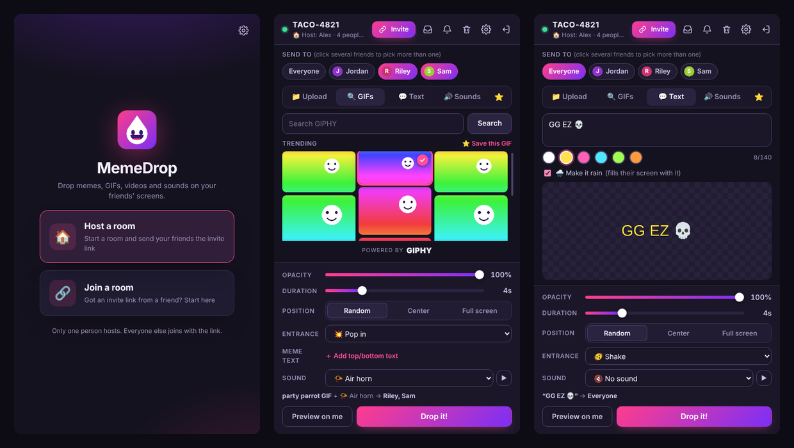
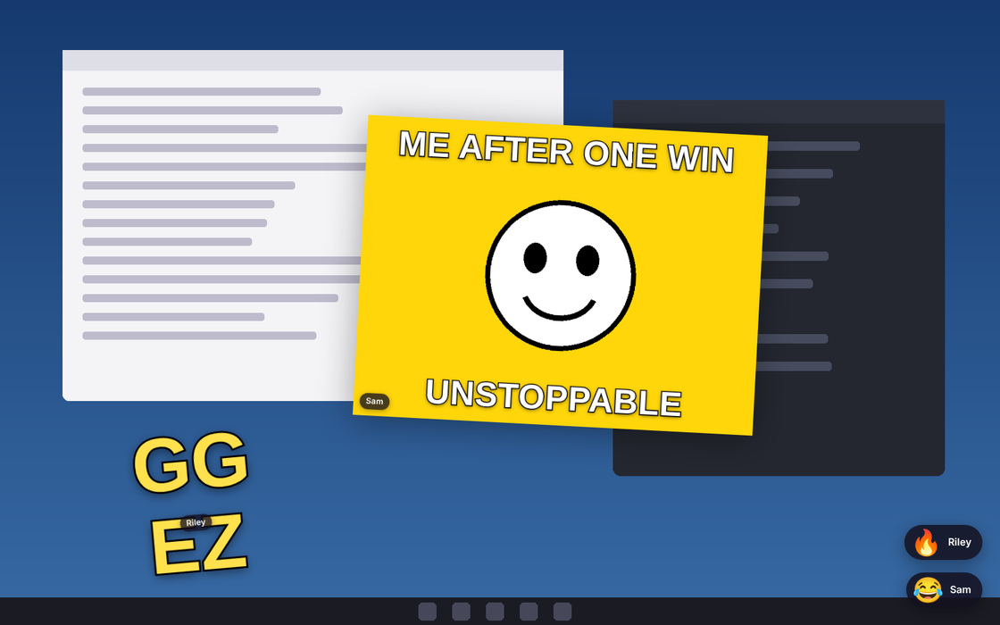
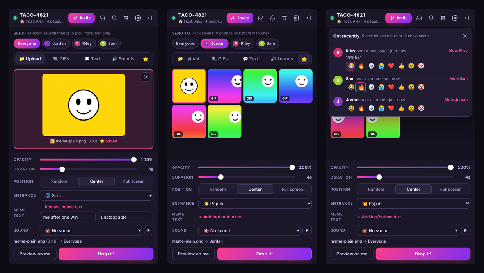
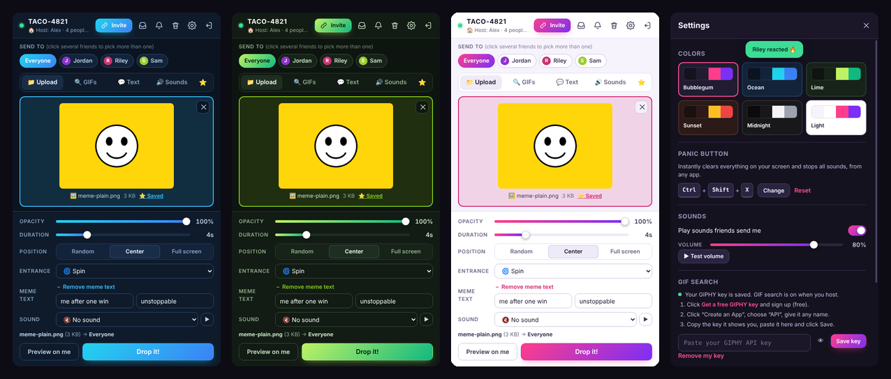

# MemeDrop

Drop memes, GIFs, videos, sounds and messages straight onto your friends' screens.

One friend clicks **Host a room** and sends everyone the invite link. Everyone else clicks it (or pastes it into MemeDrop) and they're in. Pick a friend, a few friends, or everyone, then drop an image, video, GIF, sound or a big text message. It pops up on their screen over whatever they're doing, then disappears. They can react with an emoji, and it pops up on yours.

**No terminal, no config files, no accounts.** Everything is done by clicking in the app.

<p align="center">
  
</p>
<p align="center">
  
  <br><sub>What your friend sees: memes and messages float over their apps, and their mouse clicks pass straight through.</sub>
</p>

---

## Get started

### 1. Install

Download the installer, run it, and MemeDrop opens. There's no admin password and nothing to set up.

- **Get the installer:** on this repo's GitHub page, open **Actions → CI**, click the newest run with a green tick, scroll down to **Artifacts** and download **MemeDrop-Windows-Installer** (a zip with `MemeDrop Setup 1.3.0.exe` inside). Share that `.exe` with your friends however you like (Discord, Google Drive, USB stick).
- **"Windows protected your PC"?** The installer isn't code-signed, because certificates cost money. Click **More info → Run anyway**.

### 2. One person hosts

1. Click **Host a room**.
2. Type your nickname. A fun room name is already filled in; click 🎲 for another.
3. Choose who can join:
   - **Friends anywhere**: works over the internet. The first time, MemeDrop downloads a small free helper from Cloudflare (about 30 seconds) so friends can reach you without any router settings.
   - **Only people on my Wi-Fi**: same house or network. If Windows asks about the firewall, click **Allow access**.
4. Click **Start room**. The invite link is copied for you, so paste it to your friends.

The host's MemeDrop needs to stay open (closing the window keeps it running in the tray). If the host quits, the room closes.

### 3. Everyone else joins

- **Click the invite link.** It opens a page with an **Open in MemeDrop** button.
- **Or paste it:** open MemeDrop → **Join a room**. If you've just copied the link, a **Use the invite you copied** button appears; click it, type your nickname, and **Join room**.

Anyone in the room can click **Invite** (top bar) to copy the link and bring more people.

---

## Sending stuff

1. **Send to:** **Everyone**, one friend, or click several friends to pick a group.
2. Pick what to drop:
   - **📁 Upload**: drop an image or video on the box, click to browse, or press **Ctrl+V** to paste a screenshot. Images: PNG, JPG, GIF, WebP up to 5 MB. Videos: MP4 or WebM up to 20 MB.
   - **🔍 GIFs**: trending GIFs and search, powered by GIPHY. Click to select; double-click to send instantly.
   - **💬 Text**: type a message (up to 140 characters), pick a color, and press **Enter**. It lands as big outlined meme text. Tick **🌧️ Make it rain** and a short message or emoji (💀, GG, F) pours down their whole screen instead.
   - **⭐ Saved**: your favorites. Pick an image, video or GIF, click **⭐ Save**, and it's here next time, a click away (double-click sends it right away). Saved memes stay on your PC.
   - **🔊 Sounds**: a soundboard (air horn, sad trombone, drum roll, ta-da…), or **upload your own** MP3/WAV/OGG/M4A. Click to hear it, double-click to send it straight away.
3. Adjust:
   - **Opacity**: from faint (10%) to fully solid (100%).
   - **Duration**: 1–15 seconds. For videos you can tick **Play the whole clip** instead (up to 60 seconds).
   - **Position**: **Random** (somewhere random, slightly tilted), **Center**, or **Full screen**.
   - **Entrance**: how it arrives: pop in, drop from the top, bounce, shake, spin, zoom, or just appear.
   - **Meme text**: click **Add top/bottom text** to put classic meme captions on any image, GIF or video.
   - **Sound**: add a sound effect to any image, GIF or message. Videos can also play their own sound.
4. **Preview on me** shows it on your own screen first. **Drop it!** (or **Ctrl+Enter**) sends it.

<p align="center">
  
</p>

## Getting memes

Drops pop up with the sender's name in the corner, then fade away. They never steal focus or block your mouse, so you can keep typing, clicking or gaming.

| | |
| --- | --- |
| **Panic key** (Ctrl+Shift+X by default) | Instantly clears everything on your screen and **stops all sounds**, from any app. |
| ⚙️ **Settings → Panic button → Change** | Press any shortcut you like (e.g. Ctrl+Alt+P, or F9). MemeDrop tells you if another app already uses it. |
| 📥 button | What friends sent you recently. Click an emoji (😂 🔥 💀 😭 ❤️ 👍 😮 🤡) to react, and it pops up in the corner of their screen. |
| **Mute *name*** (in 📥) | Mute just one friend: their drops and reactions stop showing up for you. Unmute them in ⚙️ **Settings → Incoming memes**. |
| 🔔 button | Mute everything friends send. |
| ⚙️ **Settings → Sounds** | Turn friends' sounds off or set the volume. |
| ⚙️ **Settings → Colors** | Six color themes: Bubblegum, Ocean, Lime, Sunset, Midnight, Light. |
| ⚙️ **Settings → Incoming memes** | **Show on**: pick which screen memes appear on (if you have more than one). **Start MemeDrop with Windows**: it starts quietly by the clock. |
| Tray icon (by the clock) | Right-click for the same quick switches, and **Quit**. |

<p align="center">
  
</p>

Closing the window keeps MemeDrop running in the tray, so memes still arrive. Right-click the tray icon → **Quit MemeDrop** to really quit.

**Light on your PC.** When the window is closed, MemeDrop frees that window's memory. The see-through overlay closes itself after a minute with nothing on screen, and sounds release the audio device when they finish. GIF search previews also stop animating while you're in another app. In our tests, sitting in a room in the tray used about a third less memory than v1.1 and practically no CPU.

---

## GIF search (one-time, host only)

GIF search uses GIPHY, which needs a free key. **Only the host needs one**, and everyone in the host's room gets GIF search automatically.

1. In MemeDrop, open the **GIFs** tab (or ⚙️ **Settings → GIF search**) and click **Get a free GIPHY key**.
2. Sign up, click **Create an App**, choose **API**, and give it any name.
3. Copy the key, paste it into MemeDrop and click **Save key**. GIF search switches on for the whole room immediately.

Your key stays on your PC (encrypted by Windows) and is never sent to your friends. GIPHY's free keys allow about 100 searches an hour; MemeDrop caches results so a group of friends stays well under that.

As GIPHY requires, the GIFs tab shows **Powered by GIPHY** and GIFs on screen are labelled **via GIPHY**. GIF files aren't relayed: only the GIPHY link is sent, and each friend's app loads it from GIPHY directly.

---

## Troubleshooting

- **The overlay is a black box instead of see-through.** Some graphics drivers don't like transparent windows. Right-click the MemeDrop shortcut → **Properties** → add ` --no-gpu` to the end of **Target**.
- **Memes don't show over my game.** Games in *exclusive* fullscreen draw over everything. Switch the game to **borderless windowed** (sometimes called "fullscreen windowed").
- **"Ctrl+Shift+X is taken by another app."** Pick a different panic key in ⚙️ Settings. While MemeDrop runs, your panic key belongs to MemeDrop (e.g. Ctrl+Shift+X normally opens VS Code's Extensions panel).
- **Friends can't connect ("Friends anywhere").** Click **Restart room** if MemeDrop says the connection dropped, then send the new invite link. Some school or work networks block Cloudflare tunnels; try **Only people on my Wi-Fi** if you're on the same network.
- **Friends can't connect ("Only my Wi-Fi").** Make sure everyone's on the same network, and that you clicked **Allow access** when Windows asked. If you missed it: Windows Security → Firewall → *Allow an app through firewall* → tick MemeDrop.
- **No sound.** Check ⚙️ Settings → Sounds is on and the volume isn't at 0, and that the sender didn't untick **Play its sound** on their video.
- **GIF search says it's off.** The host needs to add a GIPHY key (see above).

---

## Limits and safety

There are no accounts, so anyone with the invite link can join. Only share it with friends.

- **Files are checked by their contents**, not their names. Images bigger than 16384 px on a side or 64 megapixels are refused, so a tiny "image bomb" can't freeze anyone's PC.
- **Sizes:** images 5 MB, videos 20 MB, uploaded sounds 3 MB. Whole-clip videos and sounds stop after 60 s.
- **GIFs** can only come from GIPHY, and the overlay window is locked down so it can't load anything else.
- **Spam limits:** about 8 drops per 10 seconds per person, 12 reactions per 10 seconds, 20 GIF searches a minute, 30 people per room, and at most 6 things on screen at once.
- **Messages and captions** are plain text (140 and 80 characters; rain only for 20 or fewer). Colors and effects come from a fixed list, so nobody can sneak styling or links into your overlay.
- **The app itself:** its pages run sandboxed without Node access, can't open pop-ups or navigate away, and camera/microphone/other permission requests are always denied.

---

## Advanced: run a standalone server

You don't need this, because hosting inside the app covers normal use. It's for an always-on room that doesn't depend on someone's PC being on.

```bash
cd server
npm install
cp .env.example .env      # Windows: copy .env.example .env
npm start
```

This needs **Node.js 20.12+**. Put a GIPHY key in `server/.env` (`GIPHY_API_KEY=…`) to enable GIF search; `.env` is gitignored. It works on any Node host with WebSockets (Render, Railway, Fly.io, a VPS…).

Friends join with **Join a room → No link? Connect with a server address**, or with an invite link of the form `https://your-server/join/ROOM`.

| Setting (`server/.env`) | Default | |
| --- | --- | --- |
| `GIPHY_API_KEY` | *(empty)* | Turns on GIF search |
| `PORT` / `HOST` | `8787` / `0.0.0.0` | Where to listen (HTTP + WebSocket share the port) |
| `MAX_IMAGE_MB` / `MAX_VIDEO_MB` / `MAX_SOUND_MB` | `5` / `20` / `3` | Upload size caps |
| `MAX_ROOM_SIZE` | `30` | People per room |
| `GIPHY_RATING` / `GIPHY_LANG` | `pg-13` / `en` | GIF content rating and search language |
| `GIPHY_CACHE_SECONDS` | `300` | How long search results are cached |

---

## Development

```
server/src/            the relay: rooms, drops, limits, GIPHY proxy, invite page
client/src/main/       Electron main process: app, hosting, Cloudflare tunnel, connection, overlay, tray, settings
client/src/renderer/   control window (UI) and overlay window
client/src/shared/     invite links, panic-key recorder, built-in sounds, validation, layout
client/src/relay/      generated copy of server/src (scripts/sync-relay.js), so the app can host
```

```bash
cd server && npm install && npm test     # relay tests (real sockets, fake GIPHY)
cd client && npm install && npm test     # app logic, invites, hotkeys, tunnel, hosting
cd client && npm run test:e2e            # launches the real app; on Windows also checks real screen pixels
cd client && npm start                   # run the app from source
cd client && npm run dist                # build the Windows installer → client/dist/
```

CI runs all of this on every push, including the end-to-end test against the packaged `MemeDrop.exe` on a real Windows desktop. It uploads the installer and the screenshots as artifacts.

To test with **two copies on one PC**, give the second its own settings folder:

```powershell
$env:MEMEDROP_USER_DATA = "$env:TEMP\memedrop-2"; npm start
```

The built-in sounds are synthesized in code ([`client/src/shared/sounds.js`](client/src/shared/sounds.js)), so there are no audio files to license. The wire protocol is documented at the top of [`server/src/relay.js`](server/src/relay.js).
